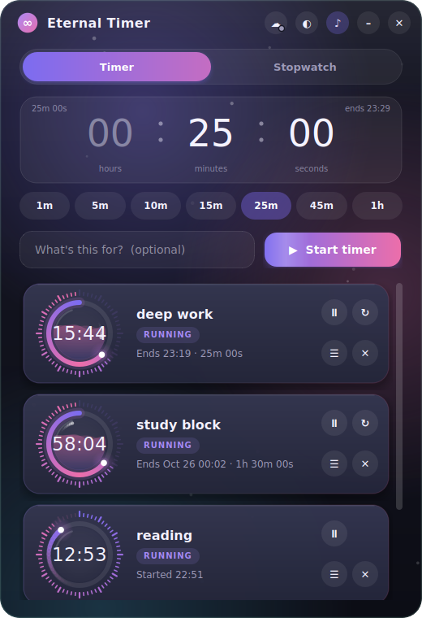
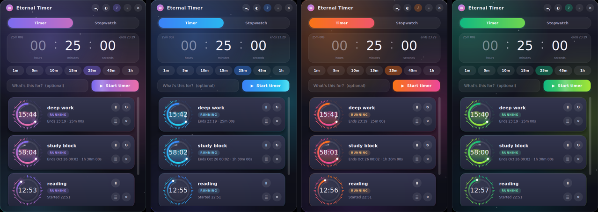

# Eternal Timer

**Timers and stopwatches that survive shutdowns and power cuts** — with an Android companion that keeps
counting, and ringing, when your PC can't.



## Why

Most timers die with the machine they run on. Eternal Timer never stores a "live" countdown. Every timer and
stopwatch is saved as absolute timestamps the instant you start, pause or resume it, so reopening the app after a
reboot or a power cut just compares those timestamps with the clock and shows exactly the right time. There is
no "save on exit" step to miss.

Add the phone and it goes one step further: a copy of your timers lives on the phone too, so when the power
goes out the phone is still counting down and rings on its own.

## What's in the box

| | Desktop (Linux) | Android |
|---|---|---|
| Timers and stopwatches, any number at once | ✔ | ✔ |
| Survives reboots and power cuts | ✔ | ✔ |
| Alarm when a timer finishes | ✔ sound + tray notification | ✔ exact alarm, full-screen over the lock screen |
| Per-timer history: every pause, and gaps from power cuts / shutdowns / closed app | ✔ | ✔ (shows the history it has) |
| Live notification per timer with **Pause / Resume** | — | ✔ |
| Time entry | type, scroll, drag or tap presets | scroll wheels or tap presets |
| Themes (Aurora, Ocean, Sunset, Mint) and calm mode | ✔ | ✔ |
| Command line (`etimer`) | ✔ | — |
| Optional encrypted sync between the two | ✔ | ✔ |



## Install

### Desktop (Linux)

Developed and tested on Arch Linux (Wayland). Needs Python 3.10+ and PySide6; `python-cryptography` is needed
only for sync, and `libnotify` only for desktop notifications while the app is closed.

```bash
[git clone <repository-url>](https://github.com/Tamim180/eternal-timer.git)
cd eternal-timer
./install.sh
```

On Arch the installer offers to `pacman -S` the missing packages. On other distributions install the same
things with your package manager (or `pip install PySide6 cryptography`) and run `python3 eternal_timer_gui.py`.
The installer puts the app and the `etimer` command in `~/.local/bin`, adds a launcher entry, and sets up a small
background check (a systemd user timer) so a finished timer rings even when the window is closed.

### Android

Requires Android 8.0 or newer. Get the APK from this repository's **Releases** page (`eternal-timer-<version>.apk`),
or build it yourself with Android Studio (see [android/README.md](android/README.md)). An F-Droid listing is
planned. On first run allow notifications, so alarms can show.

### Flatpak

Not on Flathub yet. A manifest is in [`flatpak/`](flatpak/); see [docs/FLATPAK.md](docs/FLATPAK.md) to build it
locally. The Flatpak build has no background check, so a timer rings only while the app is running (it still
catches up correctly the moment you open it).

### Windows / macOS

Not supported yet. A Windows port is being considered; contributions are welcome.

## Use

**Desktop:** set a time (type `2 5 0 0` for 25:00, scroll over a segment, drag it, or tap a preset), optionally
name the timer, press *Start timer*. The ☰ button on a card opens its history; double-click a name to rename it.
The tray menu has the sound, calm-mode and warning toggles.

**Android:** tap **+**, spin the wheels (or tap a preset), then *Start*. Every running timer gets its own
notification with a live countdown and a Pause/Resume button. Long-press a card to rename it. The gear button
opens Settings (alarm sound, how long it rings, vibration, theme, calm mode).

**Stopwatches** run until you stop them, so starting one shows a deliberately dramatic reminder of that
(switch it off with "Don't warn me again", or in the settings).

**Command line** (shares state with the desktop GUI):

```bash
etimer add timer 25m "deep work"
etimer add stopwatch "reading"
etimer list
etimer pause|resume|restart|remove <id|label>
etimer history <id|label>
etimer sound on|off|test        # `etimer sound style chime` for a softer sound
```

## Phone sync — read this first

Sync is **off until you set it up** and entirely optional. Everything below only matters if you turn it on.

**How it works, in one paragraph.** Your PC and phone never connect to each other. Each makes its own outbound
HTTPS connection to a small public relay ([ntfy](https://ntfy.sh)), the way a chat app works. Every message is
end-to-end encrypted with a key derived from a pairing code that only your devices know, so the relay only
passes along unreadable text. Because a timer is just timestamps, the phone only needs to receive the *changes*
while it is online; after that it counts and rings on its own, even if the PC is dead.

**What you should know before relying on it:**

- **It uses a free third-party service with no guarantees.** The default relay is the public ntfy.sh server. It
  can have outages, change its limits or its terms. This project is not affiliated with it.
- **It can slow down or stop.** The relay rate-limits by IP address, caps message sizes and keeps messages only
  briefly. Shared IP addresses (mobile data, dorms, offices) share limits. Many devices or very many timers mean
  more traffic and a higher chance of hitting them. The apps wait and retry by themselves.
  Full list: [docs/SYNC.md](docs/SYNC.md#when-sync-can-slow-down-or-stop).
- **It is designed and tested for two devices.** A few more are fine; for a bigger setup, run your own relay
  (one URL to change; guide in [docs/SYNC.md](docs/SYNC.md#self-hosting-the-relay)).
- **Your timers keep working if sync stops.** Both devices keep their own copy and alarms never depend on the
  network. Only the *copying between devices* pauses until the relay is reachable again.
- **Treat the pairing code like a password.** Anyone with it can read and change your timers. If it leaks, turn
  sync off and pair again with a new code.
- **The relay can see metadata** (your IP address, when messages are sent, their rough size), never the contents.
  Details: [docs/SYNC.md](docs/SYNC.md#what-the-relay-can-and-cannot-see).

**To set up:** on the PC click the cloud button → *Create a pairing code*. On the phone tap the cloud button →
paste the code → *Join*. (On the command line: `etimer sync setup`, then `etimer sync join CODE` on the other side.)

## Known limitations

- The desktop app targets Linux. Other platforms are untested.
- The Android app has been developed against a single physical device; other devices and Android versions are
  untested. Alarm reliability can depend on the manufacturer's battery management — see
  [android/README.md](android/README.md#how-alarms-stay-reliable).
- Both devices' clocks need to be roughly correct, because sync resolves conflicts by timestamp.
- Not a substitute for a real alarm clock when something critical depends on it.

## Documentation

| | |
|---|---|
| [docs/SYNC.md](docs/SYNC.md) | How sync works, privacy, limits, self-hosting, troubleshooting, protocol |
| [docs/ARCHITECTURE.md](docs/ARCHITECTURE.md) | State model, history, power-cut detection, merge rules |
| [docs/FLATPAK.md](docs/FLATPAK.md) | Building the Flatpak, and the Flathub checklist |
| [docs/RELEASING.md](docs/RELEASING.md) | Publishing the APK, signing, and F-Droid |
| [android/README.md](android/README.md) | Building and using the Android app |
| [CONTRIBUTING.md](CONTRIBUTING.md) · [SECURITY.md](SECURITY.md) · [CHANGELOG.md](CHANGELOG.md) | |

## Uninstall (desktop)

```bash
systemctl --user disable --now eternal-timer-check.timer
rm ~/.local/bin/{etimer,eternal_timer_core.py,eternal_timer_gui.py,eternal_timer_sync.py}
rm ~/.config/autostart/eternal-timer-check.desktop ~/.config/systemd/user/eternal-timer-check.{service,timer}
rm ~/.local/share/applications/eternal-timer.desktop ~/.local/share/icons/hicolor/128x128/apps/eternal-timer.png
rm -rf ~/.local/share/eternal-timer      # your timers, history and settings (including the sync code)
```

## License

[MIT](LICENSE). Dependencies keep their own licenses (PySide6 is LGPL; `cryptography` is Apache-2.0/BSD).
